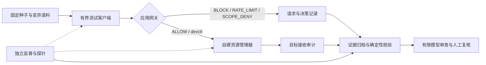

## 分轮提交产物

本板块按提交轮次列出产物位置与概要，供教师验收、伙伴复核和接续查阅。当前仅登记第一轮材料；产物已整理不等于教师已验收。

| 轮次 | 整理日期 | 产物概要 | 总入口 | 状态 |
| --- | --- | --- | --- | --- |
| 第一轮 | 2026-10-22 | 需求分析、规格说明、ADR，附需求追踪、运行约束及核验记录 | [第一轮提交索引](release/first-round-submission.md) | 已整理为评审稿，待成员确认与教师验收 |
| 后续轮次 | 待确定 | 按教师实际要求补充产物、版本及核验记录 | 暂未建立轮次索引 | 未登记，不代表已交付 |

### 第一轮：需求、规格与架构决策

| 产物 | 文档位置 | 内容概要 |
| --- | --- | --- |
| 需求分析 RA-001 v0.1 | [docs/requirements-analysis.md](docs/requirements-analysis.md) | 项目问题、需求来源与参与者、典型场景、安全风险、八条需求推导、范围和验收方式 |
| 规格说明 draft 0.3 | [docs/specification.md](docs/specification.md) | 当前接口与输入输出、八条Req、GWT场景、策略语义、适用路径及限制 |
| ADR 决策记录 | [docs/adr/README.md](docs/adr/README.md) | [0001 可控通信路径](docs/adr/0001-controlled-path.md)、[0002 评价器配置取舍](docs/adr/0002-evaluator-reasoning-profiles.md)、[0003 限流计数语义](docs/adr/0003-rate-accounting.md)、[0004 契约版本管理](docs/adr/0004-contract-versioning.md) |
| 需求追踪与运行约束 | [验收矩阵](docs/acceptance-matrix.md) · [Harness清单](docs/harness-manifest.md) | 需求到实现、检查、历史Run及版本的映射，以及实验运行器和开发/评价Agent的边界 |
| 整理核验与Diff | [核验报告](review/20261022-documentation-baseline.json) · [整理Diff](review/20261022-documentation-assets-v2/documentation-diff.txt) | 首轮整理时81项主机测试、档案审计及三个本地登记预检通过；历史文件保护与文档差异留存 |
| 契约版本留存 | [docs/contracts/README.md](docs/contracts/README.md) | 旧契约与登记快照、新草案绑定及历史模型资格边界 |

第一轮核验结果对应其记录的材料版本，后续README或源码修改不自动包含在旧报告及旧包中。独立互评、正式课程事件和最终签署的当前状态见[连续性与移交](release/continuity.md)及[提交清单](release/submission-checklist.md)。后续每轮在本表增加实际日期、产物概要、独立索引与状态，并保留上一轮的版本和证据。

---

<div align="center">

# QNX IPC Security Lab

**面向 QNX 8.0 自建资源管理器的 IPC 对抗性测试与防御验证**

固定语料 · 应用网关 · 独立观测 · 故障恢复 · 可追踪证据

[快速开始](#快速开始) · [实验结果](#实验结果) · [QNX 原生实验](#qnx-原生实验) · [文档导航](#文档导航) · [当前进度](#当前进度)

</div>

---

## 项目简介

本项目在自建 QNX 8.0 x86_64 虚拟机中，以 `/dev/ipcsec-lab` 资源管理器为实验对象，构建从合法 IPC、有限变异、客户端防御到独立观测与恢复的完整测试路径。

项目提供两条独立入口：**Python 主机模拟**用于验证规格、策略和实验流程；**C / QNX 原生实现**用于采集真实 `devctl` 请求、目标接收审计及恢复数据。二者的证据分别归档。

| 能力 | 实现内容 |
| --- | --- |
| IPC 测试对象 | 自定义 ECHO 请求、字段协议与合法客户端，应用载荷上限 64 字节 |
| 有界 Fuzzer | 固定种子、边界值、单字段及组合变异，支持保存语料和单例重放 |
| 客户端防御 | 类型、长度、offset、flags 校验，会话限流与逐请求授权检查 |
| 独立观测 | 监督进程、peer 心跳、目标接收审计及有限只读 OS 探针 |
| 恢复验证 | 自建服务受控退出/重启、暂停/继续与真实 IPC 超时 |
| 工程审查 | DeepSeek 有限证据审查、冻结校准、候选变更与回滚、交接包核验 |

> **当前定位：课程工程原型。** 教师已同意选题；张润泽、陈卫吉报告已完成两轮实现/验证及签署，代码复查通过，日志与版本引用待收尾。正式课程验收、邓一帆独立互评及最终提交签署仍待完成。网关位于客户端应用路径，完整系统隔离结论保持 `INCONCLUSIVE`。

## 工作原理



默认限流为每会话在 `(now − 1000ms, now]` 内最多 **10 次有效放行请求**。被拒请求不占槽，也不延长窗口；候选上限 5 仅在独立模拟演练中使用，尚未正式采用。

## 快速开始

### 1. 运行主机模拟

需要 **Python 3.10+**，运行依赖均为标准库。进入仓库根目录后执行：

```powershell
# 回归验证
python -m unittest discover -s tests -v

# 四个模拟场景：正常、无防御、启用防御、固定池反馈调度
python -m ipcsec demo

# 确定性 K1—K6 基线校准，不调用模型 API
python -m ipcsec calibrate

# 从配置的固定语料中重放一个基线用例
python -m ipcsec replay --case-id CASE-0001
```

`demo` 和 `replay` 每次创建新的 `evidence/runs/<run_id>/`，保留以下材料：

```text
<run_id>/
├── cases.jsonl     # 实际执行的用例
├── results.jsonl   # 决策、结果与关联字段
├── summary.json   # 指标及结论边界
└── manifest.json  # 源码身份、配置与证据哈希
```

模拟异常不等于真实 QNX 崩溃；单例重放也不等于重现完整的会话历史。

### 2. 核验已有证据

无需连接虚拟机，即可执行本地只读审计：

```powershell
python -m ipcsec.handoff audit
```

审计分别报告选定原生结果、成对比较、模型校准与候选演练。历史失败保持原状态，不能把“证据完整性通过”解释为“全部实验成功”或“课程已验收”。

## 实验结果

以下为已归档的代表性结果，更新于 **2026-10-17**。各行归属各自 manifest 中的历史版本，不构成当前源码的一次统一验收。

| 场景 | 观测结果 | 记录 |
| --- | --- | --- |
| 合法 IPC | 100 次 ping、1 次空载荷、重启后 100 次 ping 通过 | [合法链路](review/native-milestone.md) |
| 无防御原生变异 | 128 例：34 次正常应答、94 次预期错误、0 超时 | [Fuzzer 验证](review/native-fuzz-milestone.md) |
| 同语料启用防御 | 94 次非法输入阻断、14 次合法输入限流、20 次应答；目标接收 20 次 | [防御对照](review/native-defense-milestone.md) |
| 会话限流专测 | 24 例：22 次应答、2 次限流；另一会话及窗口恢复正常 | [限流验证](review/native-defense-milestone.md) |
| 动态授权 | baseline / defense 各 24 例，分别为 8 次转发、16 次拒绝 | [授权验证](review/native-authorization-milestone.md) |
| 受控退出与重启 | 前后各 10 次正确应答；停机返回 `ENOENT`，新 PID 恢复 | [恢复验证](review/native-recovery-milestone.md) |
| 受控暂停与超时 | 约 2.002 秒返回 `ETIMEDOUT=260`，同 PID 恢复；目标审计 21 条 | [暂停验证](review/native-stall-milestone.md) |
| 模型工程校准 | 修订后构造样例 10/10、有限真实材料审查 3/3 符合预期 | [校准与失败分析](review/deepseek-calibration-milestone.md) |
| CH-01 候选与回滚 | 模拟 10/5/10 三组各 22 例通过；21 例计数差异修复回归通过 | [变更与修复](review/e2-e3-preparation-milestone.md) |

上述模型3/3属于历史v1材料，不能转移为当前v2资格。模型样例匹配不代表总体准确率；真实材料审查中的完整隔离项为“证据不足”。原生限流仍使用预算 10，候选 5 尚无 QNX 实测。

完整运行 ID、比较关系及限制见 [证据索引](review/evidence-index.md)。暂停实验的历史失败与修复过程见 [问题记录](review/native-stall-issue.md)。

## QNX 原生实验

需要合法可用的 **QNX SDP 8.0**、自建 QNX x86_64 虚拟机，以及按手册配置的专用 SSH 密钥和已固定的主机身份。当前构建、建机与部署脚本面向 Windows / PowerShell。

请先按 [VM 环境手册](release/qnx-vm-runbook.md) 和 [原生接口说明](native/qnx/README.md) 完成环境准备，再执行：

```powershell
# 严格编译原生服务、客户端、Fuzzer 与监督程序
./scripts/Build-QnxNative.ps1

# 仅输入已登记、获授权的自建实验 VM 地址
$qnxAddress = Read-Host '已登记的 QNX 实验虚拟机 IPv4 地址'

# 合法链路 Smoke
./scripts/Deploy-QnxSmoke.ps1 -TargetAddress $qnxAddress

# 有界原生防御场景
./scripts/Deploy-QnxFuzz.ps1 -TargetAddress $qnxAddress -Count 128 -Mode defense -Suite mixed
```

| 后续操作 | 手册 |
| --- | --- |
| 变异、baseline / defense 对照、授权及单例重放 | [原生实验手册](release/native-fuzz-runbook.md) |
| 受控退出、暂停超时与恢复 | [恢复实验手册](release/native-recovery-runbook.md) |
| 伙伴新环境部署与复现 | [伙伴复现步骤](release/partner-reproduction.md) |

原生证据保存在 `evidence/native-*/` 下；VM 磁盘、SDK、SSH 私钥与编译产物不随源码交付。

## 评价器与变更演练

**评价器与 IPC 执行链路分开，QNX 测试链路不依赖模型 API。** 当前默认供应商为 DeepSeek，模型显式指定为 `deepseek-flash`；密钥从本机 `DEEPSEEK_API_KEY` 读取。调用会产生费用，仅发送已批准的有限材料。

使用步骤、预算和冻结/核验命令见 [评价器运行手册](eval/semantic-review-runbook.md)。当前评价字段、可信预检与独立校准的待改进项见 [课程审计](review/course-compliance-audit-20261017.md)。新Schema v2区分来源、后端与验证强度，并通过固定登记重验原始档案。构造校准通过，但真实材料复测未过门；当前路由只作候选草稿，不作为正式E3通过证据，详见 [修订及负结果](review/20261019-evaluator-and-handoff.md)。模型输出始终保留人工签署入口。

CH-01 仅改变候选模拟预算，可独立运行并核验：

```powershell
python -m ipcsec.change_rehearsal run

# 使用上一步打印的目录
$changeRun = Read-Host '候选演练输出目录'
python -m ipcsec.change_rehearsal verify --folder $changeRun
```

业务决定与修复链：[计数语义](review/DEC-SEC04-rate-accounting.md) · [CH-01 提案](review/CH-01.md) · [INT-F-01](review/findings/INT-F-01-rate-accounting.md)。

## 仓库结构

```text
qnx-ipc-security-test/
├── ipcsec/          # 主机模拟、证据核验、评价器及候选演练
├── native/qnx/      # 原生协议、资源管理器、客户端与监督探针
├── configs/         # 实验范围、预算及候选配置
├── tests/           # 主机回归与证据校验测试
├── scripts/         # 构建、部署、重放与核验入口
├── eval/            # 评价契约、校准样例和操作说明
├── evidence/        # 原始运行、比较、校准及修复回归事实
├── docs/            # Intent、规格、ADR、任务与 Harness
├── review/          # Finding、实验解释、审计和签署记录
└── release/         # 启动恢复、课堂演示和伙伴交接
```

`build/` 保存本地生成物，不提交 Git。目录职责详见 [仓库地图](docs/repository-map.md)；参与修改前阅读 [工程规则](AGENTS.md)。

## 文档导航

| 我想了解… | 从这里开始 |
| --- | --- |
| 项目的范围、行为与验收 | [Intent](docs/intent.md) · [规格](docs/specification.md) · [验收矩阵](docs/acceptance-matrix.md) |
| 整体过程与课程映射 | [项目工作流](docs/项目工作流.md) · [适配评估](docs/项目适配评估.md) |
| 实际数据能支持哪些结论 | [证据索引](review/evidence-index.md) · [报告草稿](release/course-report-draft.md) |
| 如何演示、交接和独立审查 | [课堂演示](release/classroom-demo.md) · [伙伴复现](release/partner-reproduction.md) · [E3 指南](release/e3-review-guide.md) |
| 目前还有哪些缺口 | [课程审计](review/course-compliance-audit-20261017.md) · [提交清单](release/submission-checklist.md) |

## 当前进度

截至 **2026-10-19** 的历史代码复查记录为81项主机测试通过；2026-10-22整理核验另见首轮提交索引。历史自检运行仍分别保留当时的 76 项和 79 项记录，不能改写。限定原生实验与交接包已有核验记录。新增 [真实 Claim 人工复核卡](eval/real-claim-review-card.md) 与 [本地判定报告](review/20261019-local-claim-check.json)，将有限样本通过、档案一致性与系统隔离证据不足分开呈现。

统一技术自检：`python -m ipcsec.local_check run`。自动保存命令、耗时、退出码、日志与源码身份，首次失败停止；详见 [最终执行指南](release/final-execution-guide.md)。作者侧自检不代替独立伙伴和正式课堂事件。

- [x] 自建目标、合法 IPC、有界原生变异及接收审计
- [x] 客户端网关、会话限流、动态授权与限定恢复
- [x] DeepSeek 工程校准、候选变更与回滚、内部 Finding 修复
- [x] 本地交接包与解压副本自检
- [ ] E1 正式取舍、逐次 Trial 与人工成本闭环
- [x] Schema v2 来源/后端/强度分离，以及登记档案预检
- [x] 当前接管入口更新，交接器支持选定主机模拟证据
- [ ] 新Schema真实材料稳定性、独立真值及隔离评价工作区
- [x] 教师已批准选题（见 [批准记录](review/teacher-approval-20261019.md)）
- [ ] 正式 E2/E3、伙伴独立复现与校准
- [x] 两轮个人实现与交叉验证（用户报告完成并签署，代码复查通过）
- [ ] 个人任务日志/版本引用收尾、最终提交签署

交接器现按 `configs/handoff-evidence.json` 的 `simulation_paths` 选择模拟证据并重算；不打包所有重复自检目录。10月17日审计是历史检查点，修订进度见 [本轮记录](review/20261019-evaluator-and-handoff.md)。

## 本地交接包

```powershell
python -m ipcsec.handoff audit
python -m ipcsec.handoff package

$archive = Read-Host '生成的 ZIP 完整路径'
python -m ipcsec.handoff verify-bundle --archive $archive
```

输出位于 `build/handoff/<唯一目录>/`：源码与选定证据 ZIP、审计报告、源码快照及 `SHA256SUMS.txt`。包中保留历史失败和待完成状态；哈希用于完整性核验，伙伴独立复现另行记录。

## 实验边界

仅对已登记、获授权的自建目标开展测试。客户端网关可被拥有设备直接访问权的程序绕过；实验会话编号不是可信身份。受控 `SIGTERM` / `SIGSTOP` 是恢复实验，不是发现漏洞；超时也不等于崩溃。

当前探针覆盖有限，完整系统隔离保持 `INCONCLUSIVE`。最终验收以批准范围、具体版本、原始证据及人工复核为依据。
