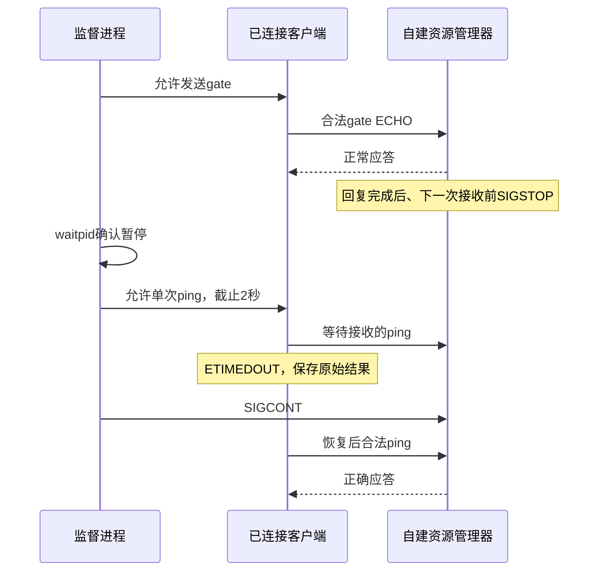

# 受控暂停与真实IPC超时验收

日期：2026-10-17。关联ISO-01、REL-01、OBS-01。
用户在获知失败停止情况后明确要求继续；新一轮限定原自建QNX 8.0 x86_64 VM与/dev/ipcsec-lab，原失败证据不变。

## 当前实测结果

| 项目 | 结果 |
| --- | --- |
| 暂停超时运行 | 20261017T130224Z-8ed73897，PASS |
| 暂停前 / 恢复后 | 各10次正确ping应答 |
| 专用检查点 | 1次合法gate ECHO正确应答，仅此请求触发受控暂停 |
| 真实超时 | 1次devctl返回QNX ETIMEDOUT=260，单调时钟耗时2,001,796,947ns，约2.002秒 |
| 服务身份 | 全过程同一目标PID 15728667；waitpid观测SIGSTOP=23后SIGCONT恢复 |
| 独立只读探针 | 总126条成功记录；正常/暂停/恢复后严格区间分别12/93/16条，其余为边界观测 |
| 接收审计 | 恰好21条：10 ping + 1 gate + 10 ping，逐条字节、PID、顺序和时间匹配，无多余延迟交付 |
| 恢复耗时 | SIGCONT请求至首个正确应答约33.12ms，单次观测，不是P95或性能达标 |
| 兜底及清理 | 6秒暂停兜底、45秒宿主截止均未触发；本轮5个子进程均回收，设备不存在 |

证据位于evidence/native-stall-runs/20261017T130224Z-8ed73897/。manifest记录当时源码、二进制和每份证据哈希，已只读复核。监督、目标、探针与三个客户端共6个不同PID。暂停期间不查询目标设备，device_present=null表示未观测；前后响应阶段才实际检查。

同一版本共享代码的停止/重启回归也通过：evidence/native-recovery-runs/20261017T130304Z-d6c6072a/，停止前后各10次正确应答、停机open返回ENOENT=2，独立探针43条成功记录，新PID恢复。重启请求至首个正确应答约36.74ms。

## 为什么专用检查点有效

检查点仅在显式--controlled-pause模式且收到合法gate ECHO时设置；普通stat/open/close或默认服务模式不能触发。这消除了先前由查询收尾处理触发暂停的竞态，避免用“进程已暂停”替代“尚未接收下一请求”的条件。
这轮只验证明确检查点下的发送侧超时与同PID恢复，未验证回复侧服务器已接收消息后的全部解除阻塞语义。原4轮失败及排查假设仍保留于native-stall-issue.md，不改写为通过。

## 结论与后续

限定场景的真实超时与恢复验收为PASS。目标状态为CONTROLLED_PAUSE，不能称为crash；完整系统隔离仍为INCONCLUSIVE，不计算隔离成功率。
37项主机回归已通过；暂停场景fixture为合成校准，真实结论以上述QNX证据为准。
下一阶段可以整理课堂演示和证据索引，并由伙伴在干净环境复现。教师Gate、个人贡献和AI使用签署仍pending；若要扩展回复侧超时或系统服务观测，应另行定义场景与范围。
